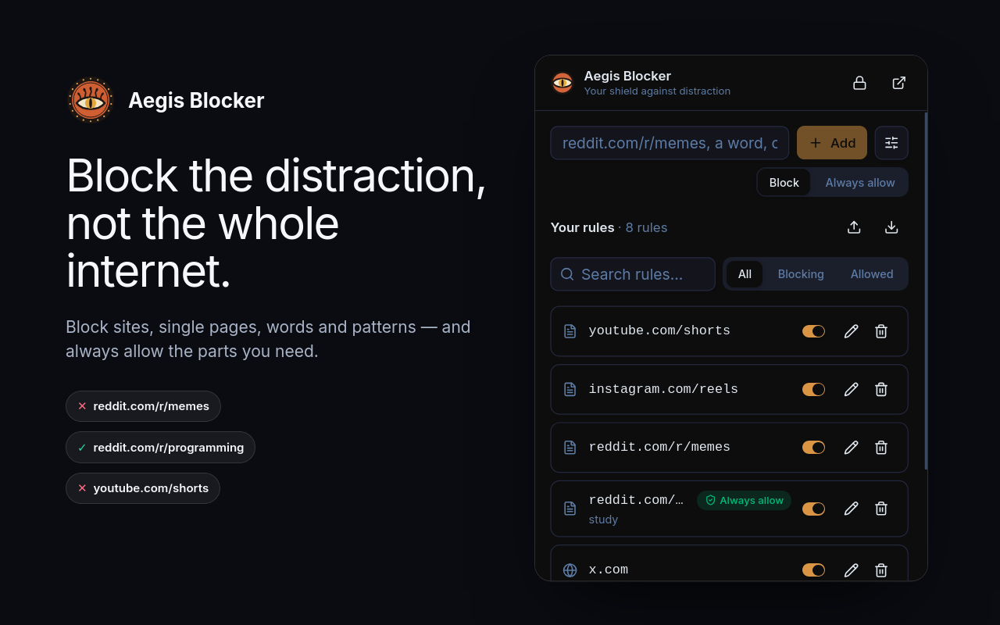
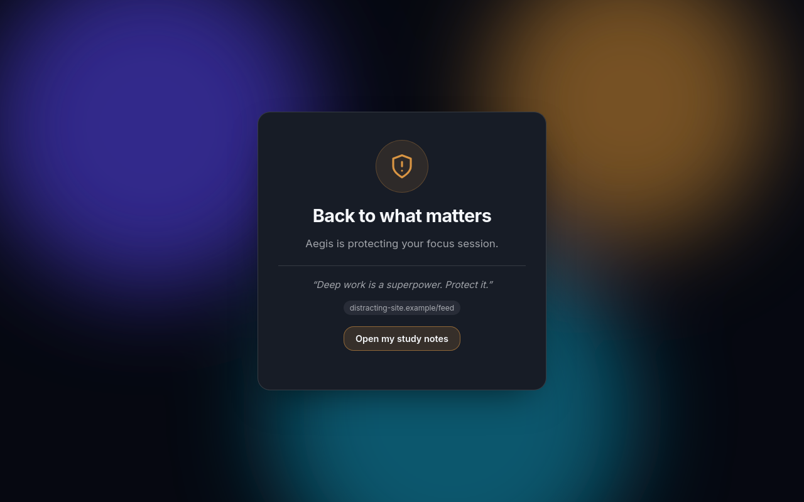
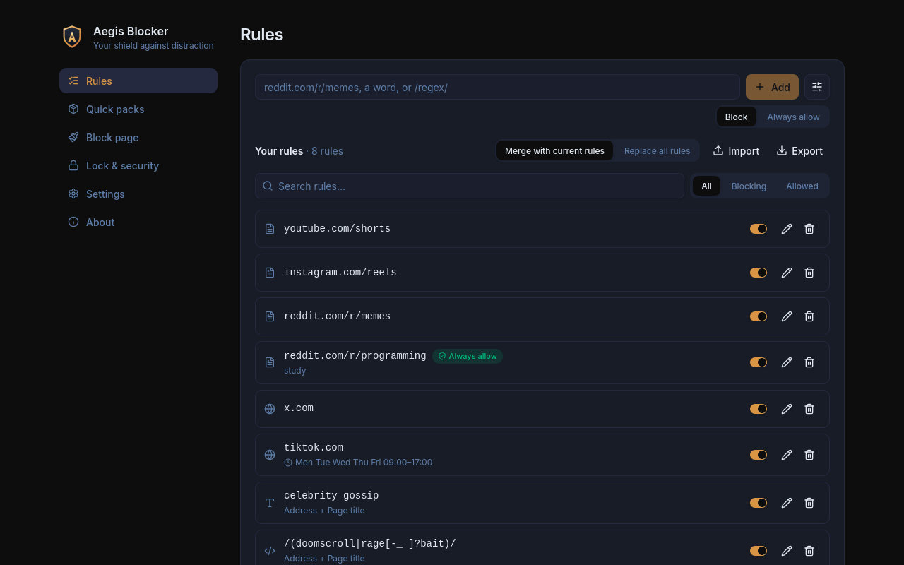

<div align="center">
  
  <h1>Aegis Blocker</h1>
  <p><strong>Block the distraction, not the whole internet.</strong></p>
  <p>A strict, private and 100% local website blocker for deep work — Chrome, Edge, Brave and other Chromium browsers.</p>
</div>

<div align="center">
  
</div>

> *"The Aegis... which produced a sound as from a myriad roaring dragons."* — The Iliad

Most blockers are blunt: they ban a whole site. Aegis lets you block exactly what pulls you away
(`youtube.com/shorts`, `reddit.com/r/memes`, a word, a pattern) and keep the useful parts of the
internet open (`reddit.com/r/programming`). It has no server, no account, no analytics and no
remote code — everything stays in your browser.

## Features

- **Granular rules** — whole sites, single pages or sections, words, and regular expressions.
  Type anything in the box and Aegis detects what it is.
  - `reddit.com` → the site and all its subdomains
  - `reddit.com/r/memes` → only that section (segment-aware: `/r/memesstudy` is not blocked)
  - `cat videos` → any address (or page title) containing the words, including search queries
  - `/(shorts|reels)/` → full regular expressions (RE2, validated and ReDoS-guarded)
- **Always-allow exceptions** — allow rules beat block rules.
- **Schedules** — block only on weekdays 09:00–17:00, overnight windows included.
- **Quick packs** — one click for social networks, short videos, streaming, chat, news, games, shopping, memes.
- **Catches single-page apps** — in-site navigation (e.g. YouTube → Shorts) is blocked too, and open tabs are swept immediately.
- **Absolute Mode** — a timed lock: you can still add blocks, but nothing can be removed, paused or
  weakened until it ends. Enforced in the background service worker, and any storage tampering during the lock is reverted.
- **Password protection** — optional; PBKDF2-SHA256 (600k iterations), brute-force throttling, one-time recovery code
  that never works during Absolute Mode.
- **A block page that is yours** — themes, colors, layouts, shapes, icons, fonts, your own image or video
  background (stored locally), your own quotes, link buttons (notes, course, calendar), an automatic redirect
  and an optional *temptation delay* (a deliberate, timed pause).
- **Import / export** — JSON backup, with validation. Imports from Aegis 1.x work too.
- **Five languages** — English, Português, Español, Deutsch, 简体中文.

<div align="center">
  
  
</div>

## Install

**From source** (Chromium-based browsers):

```bash
git clone https://github.com/ordreth/aegis-blocker.git
cd aegis-blocker
pnpm install --frozen-lockfile
pnpm build
```

Then open `chrome://extensions`, enable **Developer mode**, click **Load unpacked** and select the `dist` folder.
Finally open the extension's **Details** and enable **Allow in Incognito** so private windows are covered too.

Requirements: Node.js ≥ 24 and [pnpm](https://pnpm.io). On NixOS/Nix, `nix-shell` with a shell providing `nodejs_24` and `pnpm` is enough.

## Using it

1. Click the shield in the toolbar and type a site, a page, a word or `/regex/` — then **Add**.
2. Use **Always allow** for exceptions, or the slider icon for schedules and notes.
   Prefer a site or page rule for anything private: a website can find out which *words* or
   *patterns* you block by testing guesses against them, but not which sites or pages.
3. Open the dashboard (↗) for quick packs, the block page designer, Absolute Mode and security.
4. Caught doomscrolling? **Block *site*** appears in the popup for the site you are on.

## Privacy & security

Aegis is built so that being compromised is boring:

- **No network access at all.** Extension pages ship with `connect-src 'none'`, `default-src 'self'`,
  no inline scripts and no remote code. Block-page media and links are never fetched by Aegis.
- **Minimal permissions.** `declarativeNetRequest`, `storage`, `alarms` and http(s) host access.
  No `tabs`, no content scripts: Aegis never reads page content, only the address (and title) of
  pages it may block.
- **Local data only.** Everything lives in `chrome.storage.local` (never synced to your Google
  account). v1 data that was in `storage.sync` is migrated and wiped.
- **One validated gate.** The service worker is the only writer; every request is schema-validated,
  sender-checked and lock-checked. Imports and stored data are re-sanitised on read.
- **Hardened passwords.** PBKDF2-SHA256, per-user salt, constant-time comparison, exponential back-off.

### Honest limits

Aegis is a self-control tool, **not** protection against a determined owner. Anyone can disable or
remove an extension in `chrome://extensions`, and no extension can prevent that. Absolute Mode raises the
bar for *impulsive* decisions, not for sabotage. See [SECURITY.md](SECURITY.md) for the threat model and
how to report a vulnerability, and [PRIVACY.md](PRIVACY.md) for the privacy policy.

## Development

```bash
pnpm dev          # Vite + CRXJS with hot reload (load dist/ as unpacked)
pnpm typecheck    # TypeScript 7 (native compiler)
pnpm lint
pnpm test         # unit + UI tests (Vitest)
pnpm build && pnpm test:e2e   # real-browser tests (Playwright); set AEGIS_CHROME if Chrome is not on PATH
pnpm zip          # build and zip dist/ for the Chrome Web Store
pnpm icons        # re-render icons from scripts/assets/icon.svg
pnpm assets       # regenerate store screenshots (needs Firefox on PATH, or AEGIS_FIREFOX)
```

Stack: TypeScript 7, React 19, Vite 8, CRXJS, Tailwind CSS 4, Radix UI, Vitest, Playwright — Manifest V3.
Layout: `src/shared` (pure logic: patterns, schedule, schema, crypto), `src/background` (service worker),
`src/ui` + `src/popup` + `src/options` (React), `src/blocked` (dependency-free block page), `src/i18n`.

Store listing texts and ready-made images live in [`store-assets/`](store-assets/README.md).

## License

MIT — see [LICENSE](LICENSE).
